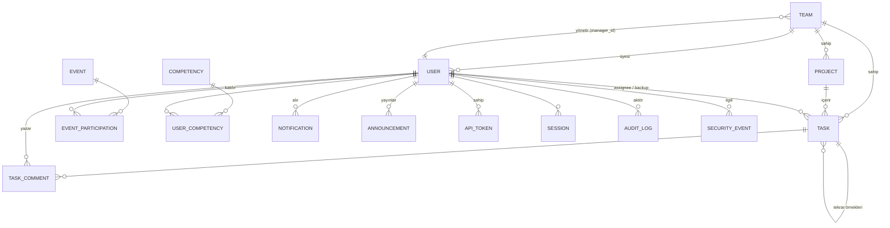

# Veri Modeli — Cyber Task Hub

PostgreSQL 17. Tüm ID'ler UUID; tüm zaman damgaları `timestamptz` (UTC). Soft delete olan tablolarda `deleted_at`. Migration: Alembic (`apps/api/migrations`).

## ER diyagramı

## Tablolar

### teams
| Alan | Tip | Kısıt |
|---|---|---|
| id | uuid | PK |
| name | varchar(100) | unique, not null |
| description | text | |
| manager_id | uuid | FK users, null |
| created_at, updated_at | timestamptz | |

### users
| Alan | Tip | Kısıt |
|---|---|---|
| id | uuid | PK |
| email | citext | unique, not null |
| full_name | varchar(120) | not null |
| title | varchar(120) | ör. "SOC Analisti" |
| role | enum `EMPLOYEE, MANAGER, DIRECTOR, AUDITOR` | not null |
| team_id | uuid | FK teams, null (direktör ve denetmen için) |
| password_hash | text | argon2id |
| is_active | bool | default true |
| failed_login_count | int | default 0 |
| locked_until | timestamptz | null |
| last_login_at | timestamptz | |
| created_at, updated_at | timestamptz | |

### projects
| Alan | Tip | Kısıt |
|---|---|---|
| id | uuid | PK |
| team_id | uuid | FK teams, not null |
| name | varchar(150) | not null, (team_id, name) unique |
| description | text | |
| owner_id | uuid | FK users |
| status | enum `ACTIVE, ON_HOLD, COMPLETED, ARCHIVED` | default ACTIVE |
| start_date, due_date | date | |
| created_by | uuid | FK users |
| created_at, updated_at, deleted_at | timestamptz | |

### tasks
| Alan | Tip | Kısıt |
|---|---|---|
| id | uuid | PK |
| type | enum `STANDARD, PROJECT` | not null |
| project_id | uuid | FK projects; **CHECK: type=PROJECT ⇔ project_id not null** |
| team_id | uuid | FK teams, not null (PROJECT ise projenin ekibi ile aynı — servis kuralı) |
| title | varchar(200) | not null |
| description | text | max 10.000 karakter |
| status | enum `TODO, IN_PROGRESS, BLOCKED, DONE` | default TODO |
| blocked_reason | varchar(500) | status=BLOCKED ise zorunlu |
| priority | enum `LOW, MEDIUM, HIGH, CRITICAL` | default MEDIUM |
| category | enum `INCIDENT_RESPONSE, VULNERABILITY_MANAGEMENT, MONITORING, PENETRATION_TEST, COMPLIANCE, THREAT_INTEL, AWARENESS, OPERATIONS, OTHER` | default OTHER |
| assignee_id | uuid | FK users, null |
| backup_assignee_id | uuid | FK users, null; ≠ assignee_id |
| due_date | date | |
| recurrence | enum `NONE, DAILY, WEEKLY, MONTHLY` | default NONE |
| recurrence_parent_id | uuid | FK tasks (şablon), null |
| occurrence_date | date | (recurrence_parent_id, occurrence_date) unique |
| started_at, completed_at | timestamptz | |
| created_by | uuid | FK users |
| version | int | optimistic locking |
| created_at, updated_at, deleted_at | timestamptz | |

İndeksler: `(team_id, status) WHERE deleted_at IS NULL`, `(assignee_id, status)`, `(project_id)`, `(due_date) WHERE status <> 'DONE'`.

Türetilmiş: **overdue** = `due_date < current_date AND status <> 'DONE'`.

Tekrarlayan task modeli: `recurrence != NONE` olan task **şablondur** (listelerde "Rutin" etiketiyle, dashboard sayımlarına dahil edilmez); worker her periyotta şablondan `recurrence = NONE`, `recurrence_parent_id = şablon` olan bir örnek üretir.

### task_comments
| id uuid PK · task_id FK · author_id FK · body text (max 5.000) · created_at · edited_at · deleted_at |

### events
| Alan | Tip | Kısıt |
|---|---|---|
| id | uuid | PK |
| title | varchar(200) | not null |
| type | enum `CONFERENCE, TRAINING, CTF, WEBINAR, WORKSHOP, MEETUP, OTHER` | |
| scope | enum `INDIVIDUAL, CORPORATE` | CORPORATE sadece direktör oluşturur |
| description | text | |
| organizer | varchar(150) | |
| location | varchar(200) | |
| url | varchar(500) | sadece https |
| starts_at, ends_at | timestamptz | ends_at ≥ starts_at |
| created_by | uuid | FK users |
| created_at, updated_at, deleted_at | timestamptz | |

### event_participations
| Alan | Tip | Kısıt |
|---|---|---|
| id | uuid | PK |
| event_id, user_id | uuid | FK; (event_id, user_id) unique |
| role | enum `ATTENDEE, SPEAKER, ORGANIZER, INSTRUCTOR` | |
| status | enum `REQUESTED, APPROVED, REJECTED, ATTENDED, CANCELLED` | |
| decided_by | uuid | FK users |
| decided_at | timestamptz | |
| note | varchar(500) | |
| created_at | timestamptz | |

### competencies
| id uuid PK · name varchar(100) unique · category enum `OFFENSIVE, DEFENSIVE, GRC, CLOUD, APPSEC, FORENSICS, NETWORK, OTHER` · description text |

### user_competencies
| Alan | Tip | Kısıt |
|---|---|---|
| user_id, competency_id | uuid | PK (birlikte) |
| level | smallint | 1–5 |
| evidence | varchar(500) | sertifika adı / link |
| verified_by | uuid | FK users, null |
| verified_at | timestamptz | |
| updated_at | timestamptz | |

### announcements
| id uuid PK · scope enum `TEAM, ORGANIZATION` · team_id FK (scope=TEAM ise) · title varchar(200) · body text (max 5.000) · author_id FK · pinned bool · created_at · deleted_at |

### notifications
| Alan | Tip | Kısıt |
|---|---|---|
| id | uuid | PK |
| user_id | uuid | FK, alıcı |
| type | enum `TASK_ASSIGNED, TASK_BACKUP_ASSIGNED, TASK_STATUS_CHANGED, TASK_COMMENTED, TASK_DUE_SOON, TASK_OVERDUE, PARTICIPATION_DECIDED, ANNOUNCEMENT` | |
| title | varchar(200) | |
| body | varchar(1000) | |
| entity_type, entity_id | varchar, uuid | bağlantı |
| read_at | timestamptz | |
| email_status | enum `NONE, PENDING, SENT, FAILED` | |
| dedup_key | varchar(200) | unique, null — aynı bildirimin tekrarını önler |
| created_at | timestamptz | |

### api_tokens
| id uuid PK · user_id FK · name varchar(100) · prefix char(8) (görüntüleme) · token_hash char(64) unique · scopes text[] · expires_at · last_used_at · revoked_at · created_at |

### sessions
| id_hash char(64) PK · user_id FK · csrf_token_hash · ip inet · user_agent varchar(300) · created_at · last_seen_at · expires_at |

### audit_logs (append-only; uygulama DB kullanıcısının UPDATE/DELETE yetkisi yok)
| Alan | Tip |
|---|---|
| id | bigserial PK |
| occurred_at | timestamptz |
| actor_id | uuid null (system için null) |
| actor_type | enum `USER, API_TOKEN, SYSTEM` |
| action | varchar(60) — ör. `task.create`, `task.transition`, `user.role_change`, `report.export` |
| entity_type, entity_id | varchar, uuid |
| changes | jsonb — `{field: [eski, yeni]}`; secret alan yok |
| ip | inet |
| user_agent | varchar(300) |
| request_id | varchar(64) |
| result | enum `SUCCESS, DENIED, FAILED` |

### security_events
| id bigserial PK · occurred_at · type enum (bkz. OBSERVABILITY.md) · severity enum `INFO, LOW, MEDIUM, HIGH` · user_id null · ip inet · request_id · details jsonb (maskeli) |

### jobs / job_runs
Worker kuyruğu ve çalışma kayıtları (ADR-0004).
