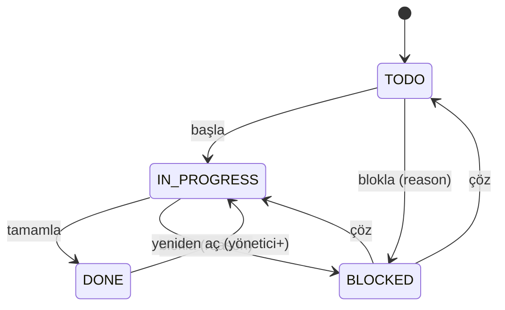

# Task yaşam döngüsü — algoritma



## `transition(user, task, to, version, reason)`

```
1. task = repo.get_visible(user, task_id)            # kapsam dışı → 404
2. if task.version != version: raise Conflict(409)
3. allowed = ALLOWED[(task.status, to)]               # tablo aşağıda
   if not allowed: raise InvalidTransition(422)
4. if not policy.can_transition(user, task, to): security_event(AUTHZ_DENIED); raise Forbidden(403)
5. if to == BLOCKED and not reason: raise Validation(400)
6. task.status = to
   if to == IN_PROGRESS and task.started_at is None: task.started_at = now()
   if to == DONE: task.completed_at = now()
   if from == DONE: task.completed_at = None             # yeniden açma
   task.blocked_reason = reason if to == BLOCKED else None
   task.version += 1
7. audit.record("task.transition", task, {status: [from, to]})
8. notify(TASK_STATUS_CHANGED, to = {created_by, team.manager} - {user})
9. return task
```

| from \ to | TODO | IN_PROGRESS | BLOCKED | DONE |
|---|---|---|---|---|
| TODO | — | A | A | ✗ |
| IN_PROGRESS | ✗ | — | A | A |
| BLOCKED | A | A | — | ✗ |
| DONE | ✗ | M | ✗ | — |

A = assignee, backup veya yönetici+ · M = sadece yönetici+ · ✗ = geçersiz (422)
